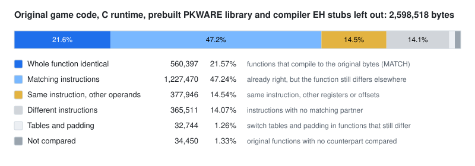

# D2VP Vanilla+QoL

<a href="https://madeopenly.com/?t=325ab9ffa5494159843c9f9999b41dc3" title="Made Openly: Mostly AI">
  
</a>

[](https://github.com/VTSTech/D2VP-QoL/releases/latest)
[](tools/check-vanilla-plus.sh)
[](https://github.com/jaenster/redivivus)
[](https://discord.gg/xQXpH5Nj5)

Diablo II: Lord of Destruction 1.14d, reverse-engineered into C++ that builds and runs —
with **Vanilla+** on top: a fix-and-QoL layer maintained by VTSTech directly in the
recovered source, plus a `glide3x.dll` that renders the game through Vulkan with a
libSlang shader chain. The wrapper is its own project and repository:
[Glide3xVK](https://github.com/VTSTech/Glide3xVK).

The recovered game source comes from
[Redivivus](https://github.com/jaenster/redivivus) (`Game.exe` recovered
function-by-function; it does for the program host, renderers, sound, input, files and
network what [D2MOO](https://github.com/ThePhrozenKeep/D2MOO) does for the game
mechanics). This fork keeps that tree current with upstream and adds the Vanilla+
surface: crash fixes, widescreen UI support, opt-in quality-of-life features and a
settings page — nothing silently changes gameplay. Upstream builds `d2.exe`; this fork
ships the client as **`d2vp.exe`**.

## Scope

Single-player, made to study, preserve and play the game. Online play on Battle.net is
outside its scope: not designed, tested or supported for it. The repository holds no
game data — MPQs and CD keys come from your own 1.14d install.

## Features (opt-in, default OFF)

With no `d2vp.ini` next to `d2vp.exe`, the game behaves like retail 1.14d byte-for-byte
(missing ini/section/key = vanilla; keys hot-re-read every ~2 s; a missing ini is
auto-created with a documented all-defaults template). Everything below also toggles
in-game: **Esc → Options → "Vanilla+ Options"**.

| Feature | `d2vp.ini` key | What it does |
| --- | --- | --- |
| Show Items Toggle | `[features] alt_toggle` | Each Alt press flips ground-item labels on/off (D2R parity); latched labels survive clicks, and clicking a label or sprite picks the item up. |
| Portable saves | `[features] portable_save` | Saves read/write `<game folder>\save` instead of the registry-resolved path; registry untouched. |
| Auto Gold Pickup | `[features] auto_gold` | Gold piles in pickup range are collected when you walk over them, via the game's own server-side pickup path. Gold only; never moves your character. |
| Persistent Globe Text | `[features] globe_persistent` | Retail's above-orb Life/Mana readout stays visible without hovering. Pure display. |
| Item Level Tooltips | `[features] item_ilvl` | Appends ` (N)` to the item name on every item tooltip. |
| Shared Stash | `[features] shared_stash` | An outlined "Shared" tab over **ten** retail-shaped stash pages every character on the PC shares (items + one gold pool survive the character), with `‹`/`›` pager arrows; stored in its own `_d2vp_shared.sss` — character `.d2s` files stay retail-compatible. |
| No Panel World Shift | `[features] no_panel_shift` | With one panel open at the wide layouts the world stays exactly where it was — the panel floats over an unmoved camera instead of the vanilla quarter-screen slide. |
| Mana Burn Fix | `[features] mana_burn_fix` | Repairs retail's Mana Burn bug (256x the intended mana drain, 512x in Hell) to the designed 66–100% of monster-level damage, matching D2R post-2.4. |
| Shift Item Compare | `[features] shift_compare` | Hold **Shift** over an equippable item and a second tooltip draws beside it: the item you have equipped for that body slot (D2R hover-compare parity) — inventory, stash, cube, trade, vendor; shield/quiver hovers compare the off-hand, weapons the primary. |

No balance changes, no save-format changes: `.d2s`/`.d2x` layouts stay untouched, and
every feature ships OFF. The wider candidate slate is scoped in
[FEATURES.md](FEATURES.md); nothing lands without a config gate.

## Status

Current: **`Vanilla+0.0.8-R127`** (line 1 of `d2boot.log` pins any build).

- **Shipped** (short form — per-release detail: [CHANGELOG.md](CHANGELOG.md)): the
  **Shift Item Compare** feature with its shield-slot fix (R125/R126, field-verified),
  the **D3D fullscreen boot-crash fix** (R124, field-verified), the **eighth upstream
  sync** (R123, Ghidra DB 1948 — includes upstream's "Duriel's death no longer
  crashes"), the **R109–R122 wide-resolution arc** — the 1344x700 / 1366x768 /
  1920x1080 video-options stops with hosted-stretch fullscreen and the wide-view
  rendering campaign — and the **Mana Burn Fix** (R106–R108). Earlier tags on the
  [releases page](https://github.com/VTSTech/D2VP-QoL/releases).
- **Field-verified**: boot → intro → title → character select → in game; Direct3D and
  Glide (`-3dfx`) rendering; sound end to end; the six-stop resolution ladder; the full
  smoke belt passed on the R83 and R104 builds
  ([#24](https://github.com/VTSTech/D2VP-QoL/issues/24),
  [#28](https://github.com/VTSTech/D2VP-QoL/issues/28)); `d2vp.exe` is field-played
  daily.
- **Open issues (1)**: the Refilling Shrine XP buff
  ([#25](https://github.com/VTSTech/D2VP-QoL/issues/25), triage pending). Recently
  closed: #26 (720p panel margins + `no_panel_shift`), #22 (Bloodraven turn-in), #18
  (attribute-point crash), #8 (necro skeleton tint).
- A crash writes a symbolised report (`d2crash-<date>-<time>.txt`) next to the
  executable; a 12 s hangwatch dumps one if the main loop ever stops beating. See
  [Crash reports](#crash-reports).

## Install

1. Grab the latest release 7z from the
   [releases page](https://github.com/VTSTech/D2VP-QoL/releases) and extract it
   into your Diablo II: LoD 1.14d folder (next to `Game.exe`).
2. Run `d2vp.exe -w`. That's the Vanilla+ client; `glide3x.dll` sits beside it for the
   wrapper route (`-3dfx`), launcher/debug scripts included.
3. Optional: `d2vp.exe -nointro` skips the two intro videos and the auto-played title
   cinematic — boot goes straight to the title screen. In-game cutscenes are unaffected.

Upgrading: extract over the previous install — saves, realm logins and `d2vp.ini` carry
over.

## Build

You need your own Diablo II: LoD 1.14 installation; this repository holds no game data.
With a mingw-w64 cross compiler for 32-bit Windows, CMake and Ninja:

```sh
cmake -S . -B build -G Ninja -DCMAKE_TOOLCHAIN_FILE=cmake/mingw-i686.cmake
cmake --build build          # -> build/d2.exe
```

On Windows the same build runs natively — `tools/build-local-win11.ps1` sets up MSYS2's
i686 toolchain (one-time), then configures, builds, runs the CI gates and strips a
`d2s-<id>.exe`:

```powershell
powershell -ExecutionPolicy Bypass -File tools\build-local-win11.ps1 -Clean -DeployTo "C:\Games\Diablo II"
```

GitHub CI (mingw-i686) builds every release tag and ships `d2s-<sha>.exe` (stripped,
play/distribute) plus `d2-map-<sha>.map` (linker map, load-bearing for crash
symbolisation). More per platform: [docs/building.md](docs/building.md).

Naming: source and CI keep upstream's `d2.exe` / `d2s-<sha>.exe` names; each release
ships the client renamed **`d2vp.exe`**. The default `d2.exe` is ~300 MB **on purpose**:
-O0 with full DWARF so the in-process fault handler can write the *symbolised*
`d2crash-*.txt` at crash time; `strip` removes only the DWARF. Linking is fully static.

## Releases

Every shipped release with its change list: [`CHANGELOG.md`](CHANGELOG.md). Tag
downloads: the [releases page](https://github.com/VTSTech/D2VP-QoL/releases).

## Verification

Two checks stand behind every release:

- **The Vanilla+ gate suite** — [`tools/check-vanilla-plus.sh`](tools/check-vanilla-plus.sh)
  pins the whole Vanilla+ surface (feature gates, 720p anchors, sound constants, boot
  telemetry, doc budgets) with **510 checks**, green at the current tip.
- **[`asm_matching/`](asm_matching/README.md)** (upstream) compiles the tree with Visual
  C++ 2005 SP1 and byte-compares each function against the 1.14d binary — a check on the
  decompilation itself: where the code comes out identical, the decompiled function was
  read correctly. Current counts live in its README and below.

At this commit, generated from version 1948 of the Ghidra database:

|Measure|Identical machine code|
|-|-|
|Functions|7,648 of 14,626 (52.3%)|
|Functions without placeholders|7,081 of 14,626 (48.4%), not counting the 567 identical functions that are placeholders (below)|
|Code|623,380 of 2,598,518 bytes (23.99%)|
|Instructions|1,814,591 of 2,598,518 bytes (69.8%), counting identical instructions in functions that still differ|

Of the 7,648 identical functions, 567 are recovered unreferenced functions: code in
1.14d that nothing calls by a direct reference (placeholders named
`Unreferenced_<address>`). These counts leave out the statically linked C runtime, C++
exception code and the PKWARE library. Over the whole binary, runtime included:
8,208 of 15,711 functions (52.2%), 722,355 of 2,748,975 bytes (26.28%).

<picture>
  <source media="(prefers-color-scheme: dark)" srcset="asm_matching/msvc8/evidence/byte-match-dark.svg">
  
</picture>

[BYTE-MATCHING.md](BYTE-MATCHING.md) explains what is compared and why whole matching
functions are a strict measure.

## Crash reports

A decompiler-reconstructed rebuild will keep yielding single-wrong-type crashes upstream
hasn't hit yet. To attribute a crash correctly, collect **both** artifacts from one repro:

| Artifact | Comes from | Tells us |
| --- | --- | --- |
| `d2crash-<date>-<time>.txt` | `d2vp.exe` (symbolised, written next to the exe) | the crashed module, function and offset in game-source terms |
| `glide3x.log` | the glide3xvk wrapper | what the wrapper was doing (frame, preset, chain) and whether the faulting thread was in wrapper code |

Rule of thumb: faulting frame in `glide3xvk`/`vk_backend`/slang → wrapper issue (the
[Glide3xVK repo](https://github.com/VTSTech/Glide3xVK)); faulting frame in `D2*`/`Storm`/`Fog` with a d2crash report →
game-source issue, report upstream if it's a reconstruction bug. Attach both files to an
issue — a crash without both artifacts cannot be attributed.
[CONTRIBUTING.md](CONTRIBUTING.md) has the detail.

With an AI agent you can read the Ghidra databases behind the tree (1.14d Windows and Mac)
through a read-only MCP server, and report such fixes with the evidence. In Claude Code:

```
claude plugin marketplace add jaenster/redivivus
claude plugin install redivivus@redivivus
```

Other agents: see https://redivivus.app/agent-setup/prompt.md.

## Project documents

**For humans:** [CHANGELOG.md](CHANGELOG.md) (per-release changes, short) ·
[VANILLA-PLUS.md](VANILLA-PLUS.md) (the charter: layering, principles, crash-triage
protocol) · [SMOKE-CHECKLIST.md](SMOKE-CHECKLIST.md) (the in-game test pass).
**For agents (verbose by design):** [FEATURES.md](FEATURES.md) (the feature slate + house
feature contract) · [handoff.md](handoff.md) (live work log, 16 KB budget) ·
[HISTORY.md](HISTORY.md) (the unbounded verbatim archive) · [plans/](plans/) (all
feature/integration plans) · [docs/merge-upstream.md](docs/merge-upstream.md) (how
upstream regenerations are merged through) · [docs/building.md](docs/building.md).

## Credits

- The recovered source is [Redivivus](https://github.com/jaenster/redivivus) by jaenster
  and contributors — this fork's `d2vp.exe` is built from it. Much of the 1.14d
  reverse-engineering comes from [blizzhackers](https://blizzhackers.dev), dzik in
  particular; the byte-match oracle in `asm_matching/` is Niehztog's;
  [D2MOO](https://github.com/ThePhrozenKeep/D2MOO) supplied many of the structure
  layouts the work started from.
- Vanilla+, the Glide3xVK wrapper and this fork: VTSTech.

## License

MIT, see [LICENSE](LICENSE). Code under `thirdparty/` keeps its own license.

The `.cpp.map` files map every function and line back to its address in 1.14d `Game.exe`. They
are part of this work under the same license: if you use them, credit Redivivus and link here.

Diablo and Blizzard Entertainment are trademarks of Blizzard Entertainment, Inc. This
project is not affiliated with or endorsed by Blizzard.
